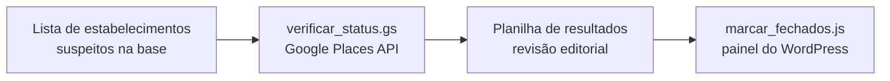

# Automação de dados de estabelecimentos — Veja Rio

Scripts que automatizaram a manutenção da base de estabelecimentos do site da **Veja Rio** (WordPress), com mais de 4.000 cadastros:

- **Status de funcionamento:** mais de 400 estabelecimentos que constavam como abertos foram verificados no Google Maps e marcados como fechados.
- **Guia Comer & Beber:** os 511 estabelecimentos do guia foram atualizados em menos de uma semana. Na mão, a 10 a 20 minutos por estabelecimento, seria até um mês de trabalho.

## O problema

A base acumulava informações desatualizadas, que chegavam direto ao leitor:

- lugares fechados que constavam como abertos
- horário de funcionamento e localização desatualizados
- lotação máxima e número de prêmios incorretos
- textos de apresentação de edições anteriores do guia

## A solução



1. **Verificação** (`verificar_status.gs`, Google Apps Script): lê a lista de uma planilha, consulta cada estabelecimento na Google Places API e grava o status em uma nova aba, com os fechados primeiro.
2. **Revisão:** a coluna "Nome no Google Maps" permite conferir se a busca encontrou o lugar certo antes de qualquer alteração.
3. **Marcação** (`marcar_fechados.js`, console do navegador): marca como fechados, no WordPress, os estabelecimentos confirmados.

### Por que pelo painel e não pela API

A API REST do site permitia leitura, mas a escrita exigia uma autenticação que não estava disponível. A solução foi reproduzir o envio do formulário de edição do próprio painel, com a sessão do editor já logado. Como o formulário é reenviado com todos os campos existentes, nenhum outro dado do cadastro é alterado.

## Resultados

| Escopo | Estabelecimentos | Resultado |
| --- | --- | --- |
| Base completa do site | 4.000+ | Mais de 400 marcados como fechados |
| Guia Comer & Beber | 511 | Atualizados em menos de uma semana, contra até um mês na revisão manual |

## Estrutura

```
src/
├── verificar_status.gs   # consulta de status via Google Places API
└── marcar_fechados.js    # marcação em lote no WordPress
```

## Como usar

**Verificação**
1. Crie uma planilha Google com uma aba **Estabelecimentos** e os nomes na coluna A, a partir da linha 2.
2. Abra **Extensões > Apps Script** e cole o conteúdo de `src/verificar_status.gs`.
3. Em **Configurações do projeto > Propriedades do script**, crie `GOOGLE_MAPS_API_KEY` com a sua chave da Google Places API.
4. Execute `verificarEstabelecimentos`. O resultado aparece em uma nova aba.

O Apps Script limita cada execução a 6 minutos. Para listas grandes, divida em lotes.

**Marcação**
1. Faça login no painel do WordPress.
2. Cole em `FECHADOS` os nomes confirmados na planilha de resultados.
3. Abra o console do navegador (F12), cole o script e pressione Enter.

## Tecnologias

Google Apps Script · Google Places API · Google Sheets · WordPress · JavaScript

## Desenvolvimento com IA

O código foi prototipado e depurado com apoio de IA generativa (Claude). A modelagem do problema, a validação dos resultados e a revisão editorial foram feitas manualmente.

## Observações

- Nenhuma credencial fica no código: a chave da API é lida das propriedades do script.
- Esta é uma versão organizada para portfólio dos scripts usados em produção; as listas de estabelecimentos foram removidas.
- O script de atualização dos textos do guia não está incluído porque continha o conteúdo editorial da revista.

---

Rodrigo Scrivano Pingret · [LinkedIn](https://www.linkedin.com/in/rodrigo-scrivano-pingret)
